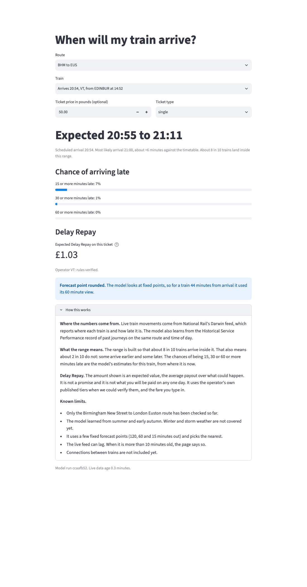
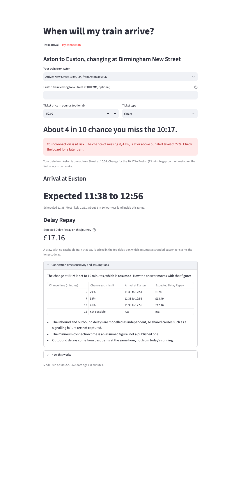

# Connection Risk Engine

Trains show on time until they don't. This gives an honest range instead: when a train will really arrive, how likely it is to be badly late, and whether a passenger will make their connection.

It uses open UK rail data on two real routes: Birmingham New Street to London Euston, and Aston to Birmingham New Street, which is the first leg of an Aston to Euston journey with a change at New Street.

## What it does

For a train that is running now, it says "Expected 09:49 to 09:54" instead of a single time. The range is built so that about 8 in 10 trains land inside it. It also gives the chance of being 15, 30 or 60 minutes late, and the expected Delay Repay in pounds when you enter your ticket price.



For the Aston to Euston journey it answers the question a passenger actually has: will I make the change? It picks the first Euston train you can make, says the chance you miss it in plain words, shows when you reach Euston, and raises an alert when the chance is high.



Everything is also available as a web API (`/risk`, `/connection`, `/inbound`, `/services`, `/health`) so another product could use it.

## Results

All figures are on a test block the model never saw: 7 days, 2026-10-09 to 2026-10-15. The model was trained on 159 days (2026-04-15 to 2026-09-22) and tuned on 14. The arrival model is MLflow run `4c88d55b` (commit `fc20d82`), written up in `reports/model_results.md`. The connection figures come from `reports/connection_backtest.json`, run at commit `4e6d697`. Brackets are 95% intervals from resampling days. "T-60" means a forecast made 60 minutes before the scheduled arrival.

**How close is the arrival range?** MAE is the average miss of the most likely arrival time, in minutes. The baseline is the best of three simple methods for that route and horizon (the timetable, the last known lateness carried forward, or the historical average), picked on validation days. Coverage is the share of trains that landed inside the 80% range, which should be about 0.80.

| Route | Forecast | Model MAE | Best simple baseline MAE | Difference | 80% range coverage |
|---|---|---|---|---|---|
| Birmingham to Euston | T-120 | 6.27 | 6.94 (historical) | -0.67 (-1.69 to +0.10), not clear | 0.81 |
| Birmingham to Euston | T-60 | 5.44 | 6.56 (last lateness) | -1.13 (-1.60 to -0.43) | 0.81 |
| Birmingham to Euston | T-15 | 3.54 | 4.13 (last lateness) | -0.59 (-0.94 to -0.21) | 0.84 |
| Aston to Birmingham | T-120 | 2.30 | 2.31 (historical) | -0.01 (-0.08 to +0.07), no gain | 0.83 |
| Aston to Birmingham | T-60 | 2.30 | 2.31 (historical) | 0.00 (-0.07 to +0.03), no gain | 0.79 |
| Aston to Birmingham | T-15 | 1.93 | 2.19 (last lateness) | -0.26 (-0.37 to -0.15) | 0.80 |

**How good are the late-train probabilities?** This is the Brier score for "at least 15 minutes late" (lower is better) against the historical frequency for the same route and hour.

| Route | Share of test trains 15+ late | Forecast | Model Brier | Baseline Brier | Model ECE | Baseline ECE |
|---|---|---|---|---|---|---|
| Birmingham to Euston | 17.7% | T-120 | 0.141 | 0.146 | 0.083 | 0.047 |
| Birmingham to Euston | 17.7% | T-60 | 0.132 | 0.146 | 0.077 | 0.047 |
| Birmingham to Euston | 17.7% | T-15 | 0.090 | 0.146 | 0.049 | 0.049 |
| Aston to Birmingham | 0.3% | all three | 0.0034 | 0.0035 | 0.003 to 0.009 | 0.010 |

The Birmingham to Euston Brier gain is clearest at T-15. At T-120 and T-60 the probabilities are less well calibrated than the historical frequency (higher ECE). On the short Aston leg a train is almost never 15 minutes late, so there is nothing to forecast and the model matches the baseline.

**Do you make the connection?** 748 test pairs of an Aston train and a Euston train that leaves 10 to 30 minutes after it is due at New Street. The baseline is the historical miss rate for the same scheduled gap, fitted on training days only. At T-15 many Aston trains had already arrived, so their delay is simply known; the honest comparison keeps only the 300 pairs whose train had not arrived when the forecast was made.

| Forecast | Pairs | Miss rate | Predicted | Model Brier | Baseline Brier | Model ECE | Baseline ECE |
|---|---|---|---|---|---|---|---|
| 60 minutes before the Euston train | 748 | 6.0% | 7.9% | 0.0525 (0.0395 to 0.0687) | 0.0528 (0.0382 to 0.0706) | 0.0235 | 0.0248 |
| 15 minutes before, Aston train not yet arrived | 300 | 15.0% | 21.3% | 0.1012 (0.0734 to 0.1422) | 0.1304 (0.0956 to 0.1819) | 0.0813 | 0.0675 |

The 80% arrival range at Euston covered 0.874 (0.823 to 0.920) of the pairs that reached Euston at T-60, which is above the 0.80 it aims for, so the range is wider than it needs to be. The alert fires at a P(miss) of 0.22. That level comes from assumed costs of 1 for a needless warning and 5 for a missed one, so it is a placeholder for product input. On test it caught 58% of missed connections with 26% of alerts correct, and cost 0.224 per pair against 0.940 for always alerting and 0.301 for never alerting.

## What did not work

- **A Delay Repay alert.** I first built a forecast alert for "you may be owed Delay Repay". On test it cost more than alerting everyone (0.814 per pair against 0.783) because the share of journeys 15 or more minutes late jumped from 13.4% in validation to 21.7% in test. Eligibility is known for certain once the train arrives, so I removed the alert. Expected Delay Repay in pounds stays as information only.
- **The 60-minute connection forecast.** Its Brier score, 0.0525, is no better than the gap-bucket baseline, 0.0528. At 60 minutes the model knows little that the timetable gap does not.
- **The 15-minute gain.** On all 748 pairs the model looked clearly better (Brier 0.0406 against 0.0528), but 448 of those pairs had already arrived. On the 300 that had not, the gain is smaller, the intervals overlap, and the model is less well calibrated than the baseline.
- **Calibration, only partly fixed.** The simulated P(miss) is too high. Rounding delays to whole minutes, as the data is, cut the validation overestimate from 9.7% to 8.3% against 6.7% realised. Platt scaling and isotonic regression were then tried on validation days and both lost to leaving the probability alone on held-out log loss (0.2656 unchanged, 0.2676 Platt, 0.2752 isotonic), so no recalibration is applied and the over-prediction remains.
- **Live data drift.** The latest drift check (`reports/drift.json`, 184 live services) flags five features. Most of that is a short live window, and the missing operator code is explained below.

## Limitations

- Two routes only. Birmingham to Manchester has been downloaded (more than 150 complete days) but is not modelled.
- Data runs from April to October 2026, so there is no winter, leaf-fall or storm season, and the test block is only 7 days, so intervals are wide.
- The 10 minute change time at New Street is an assumption. National Rail's page did not give one. The page and API state it as assumed, and the connection tab shows how the answer moves at 5, 7, 10 and 15 minutes.
- The Aston train and the Euston train are treated as independent. Shared causes such as a signal failure are not modelled.
- The Euston train's delay is drawn from past trains at the same hour, not from how it is running today.
- One fix was first spotted on test data. The whole-minute rounding was diagnosed after the first backtest printed validation and test results together, using pooled validation and test pairs. It has no fitted parameter, and its effect on validation pairs is reported above, but test pairs did inform the decision.
- The alert costs are assumed, as above.
- Operator codes are missing for 39% of live services in the latest drift check (`reports/drift.json`). All of them are services that were already scheduled when the Darwin capture began on 2026-10-15 at 10:31 UTC, so no schedule message for them exists in the raw data: 55% of services dated 2026-10-15 have no operator, and 0% of those dated 2026-10-16. The page shows "operator unknown" and no Delay Repay amount for them. Darwin's snapshot product could supply those schedules, but it would not help for anything captured since.
- The Delay Repay rules for West Midlands Railway are recorded from a manual reading of its page, because the automatic fetch was refused, and the code is shared with London Northwestern Railway, whose rules are not recorded, so no payout is priced for it.

## How it works

Two data sources feed one feature code path. The Historical Service Performance (HSP) record of past journeys is downloaded once and trains the model. Darwin, the live push feed of train movements, is captured continuously and gives the live state of each running train. Spark builds the same point-in-time features from either source, using only what was known at the forecast time, with tests that fail if anything from the future leaks in. LightGBM quantile models predict a range of delays, and conformal calibration widens it per route, forecast distance and how late the train already is, so that about 80% of trains land inside. A second model gives band probabilities, which become the chances of being 15, 30 and 60 minutes late. For connections, a Monte Carlo simulation draws the inbound delay from the model and the outbound delays from history, then counts how often the change is missed and which train the passenger then catches. Runs are tracked in MLflow, the model is loaded by the alias `champion`, and FastAPI and Streamlit serve it. It runs in Docker, and a plan-only Terraform description of an AWS deployment is in `infra/` (it has never been applied; there is no AWS account).

```
HSP history ----> Spark features ----> LightGBM quantiles + conformal ranges ----> MLflow registry
                       ^                       |                                         |
Darwin live feed ------+                       v                                         v
                                   connection simulation (Monte Carlo)          FastAPI service ---> Streamlit page
                                                                                      |
                                                                          Docker compose, Terraform plan
```

## How to run it

You need Python 3.12 with `uv`, JDK 17 for Spark (`brew install openjdk@17` on a Mac), and for the live parts a free Rail Data Marketplace account.

```
uv sync
cp .env.example .env     # fill in the four RAIL_RDM_* values; never commit this file
uv run pytest
uv run rail-risk check
```

Data and model, in order:

```
nohup ./scripts/run_capture.sh > /dev/null 2>&1 &            # Darwin capture, keep it running
nohup ./scripts/run_backfill.sh 2026-04-15 > /dev/null 2>&1 &  # HSP history, many hours
uv run rail-risk status                                       # progress of both
uv run rail-risk build-features
uv run rail-risk train                                        # a reportable run needs a clean git tree
uv run rail-risk promote --run-id RUN_ID                      # moves the champion alias
uv run rail-risk backtest-connections                         # connection scores and alert level
uv run rail-risk drift
```

Serving:

```
uv run rail-risk serve        # API on localhost:8000
uv run rail-risk ui           # page on localhost:8501
docker compose up --build api ui
curl -s localhost:8000/inbound
```

The Terraform in `infra/` is plan-only. The commands are in `infra/README.md`.

## Data licences and sources

- Darwin push port feed and the HSP service metrics and details API, both obtained through the Rail Data Marketplace (RDM) with my own account. Each product's licence is named on its RDM listing. The names are not reproduced here because they are not recorded in this repository and I will not guess them; read them from the listing before reusing the data. The raw data is not in this repository.
- Avanti West Coast Delay Repay page, https://www.avantiwestcoast.co.uk/help-and-support/delay-repay, last updated 2026-07-21 and checked 2026-10-15.
- West Midlands Railway Delay Repay page, https://www.westmidlandsrailway.co.uk/delay-repay, checked 2026-10-15 (manual reading, see above).
- England and Wales bank holidays from gov.uk (`config/bank_holidays.json`).

The code is under the MIT licence (`LICENSE`). Design decisions and corrections are logged in `DECISIONS.md`.
